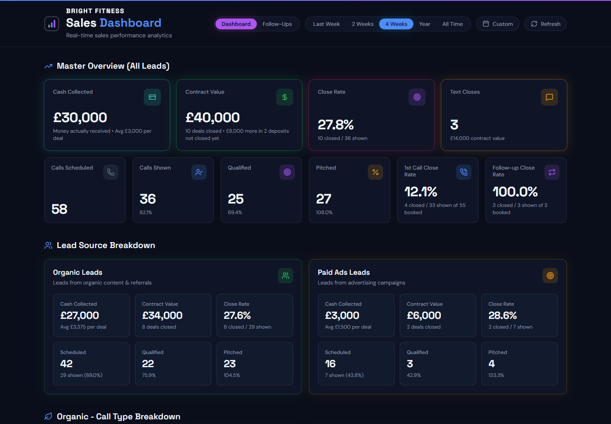
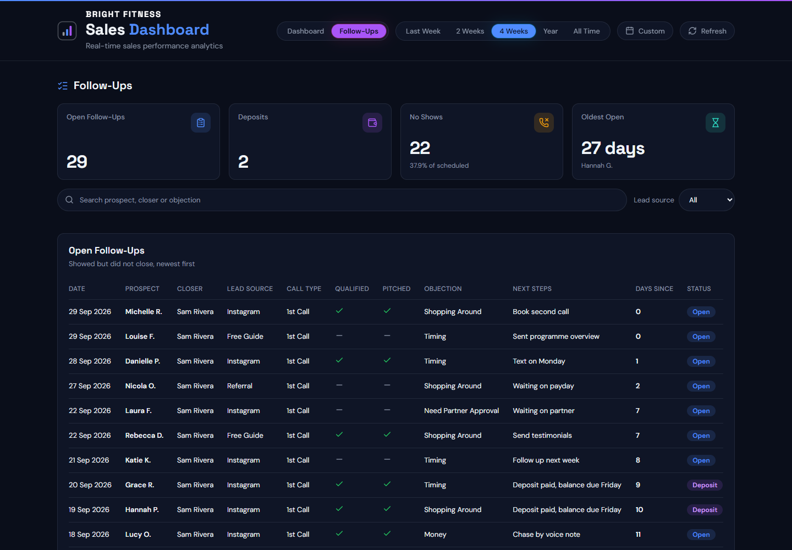
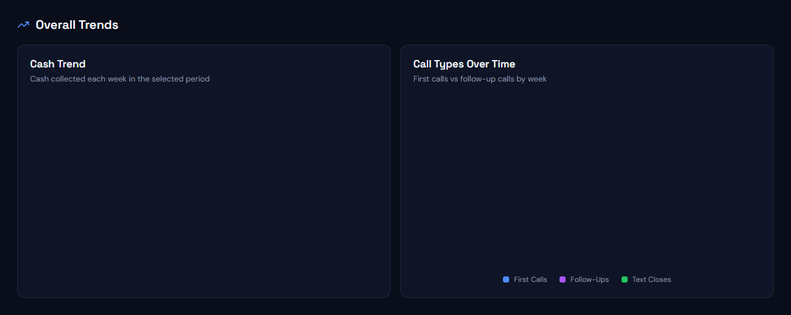
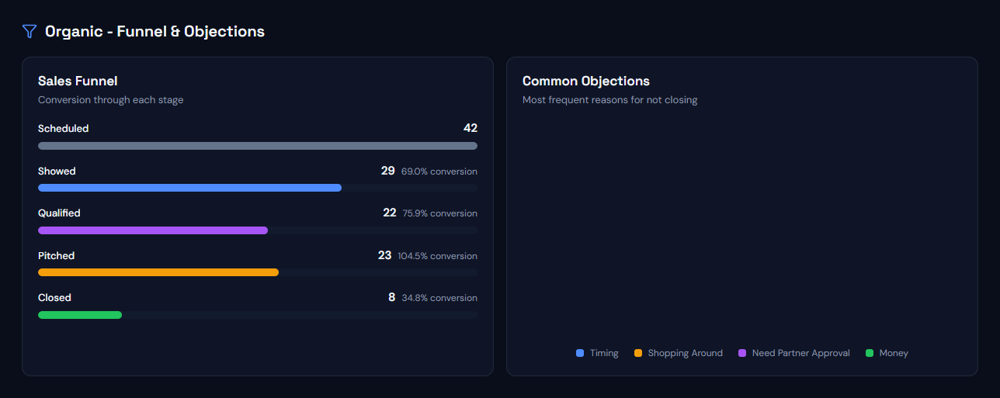
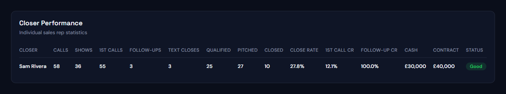
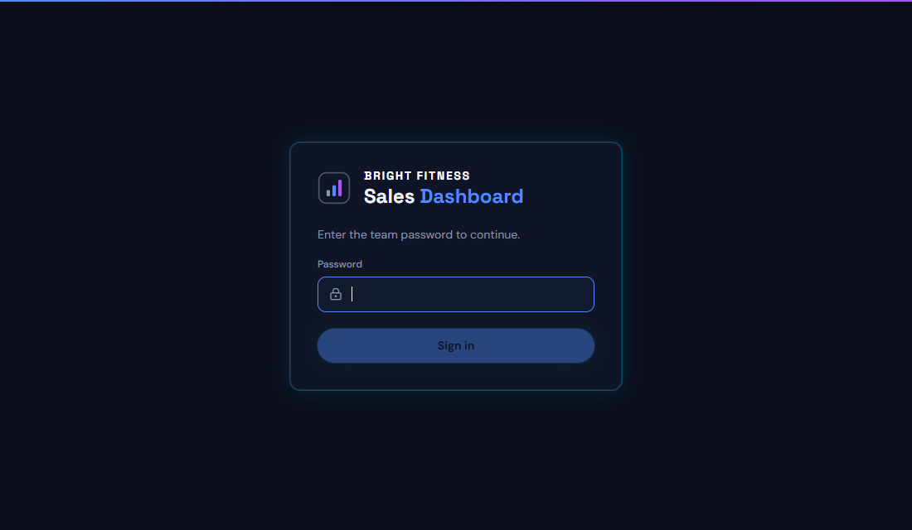

# Sales Dashboard

A sales dashboard for a small sales team. Your reps fill in a short form after every call. The
dashboard turns those forms into the numbers you actually need: how many people showed up, how many
bought, how much money came in, and who you still need to chase.

It reads from **a Google Sheet** or **an Airtable base**. You pick one. Nothing else to buy.



---

## What you get

**One page with all your numbers**, filtered by last week, two weeks, four weeks, this year, all
time, or any two dates you choose. Cash collected leads, because it is the only figure that is
money in the bank, and deposits are reported rather than quietly dropped.

**A separate Follow-Ups tab** listing everyone who showed up but did not buy, and everyone who
never turned up, so nobody gets forgotten.



**Charts that show the shape of the problem**, not just the totals.





**A table per sales rep**, so you can see who is closing and who needs help.



**A password on the front door**, because this is your revenue.



---

## Try it in five minutes, with no data at all

You do not need a sheet, a base, or an account to see it working. It ships with made up sample data.

You need [Node.js](https://nodejs.org) installed first. Get the big green "LTS" button.

**1. Download this code.** Click the green Code button at the top of this page, then Download ZIP,
then unzip it. Or if you know git:

```bash
git clone https://github.com/YOUR-NAME/sales-dashboard.git
```

**2. Open a terminal in that folder.** On Windows, right click the folder and pick "Open in
Terminal". On a Mac, right click and pick "New Terminal at Folder".

**3. Install the bits it needs.** Type this and press enter. It takes a minute.

```bash
npm install
```

**4. Make your settings file.** Copy `.env.example` and name the copy `.env`. Yes, the name is just
a dot and then "env". Open it and make sure this line is in there:

```bash
VITE_DATA_SOURCE=mock
```

**5. Start it.**

```bash
npm run dev
```

**6. Open http://localhost:5173 in your browser.**

That is it. Everything you see is invented data. Click the tabs, change the date filters, have a
poke around. When you are happy, come back and connect your real numbers.

---

## Connecting your real numbers

You have two choices. They both work exactly the same once set up, so pick whichever you already
use.

| | **Google Sheets** | **Airtable** |
|---|---|---|
| Cost | Free | Free plan works, with a catch |
| Setup time | About 20 minutes | About 10 minutes |
| Hardest part | Making a robot account for Google | Nothing really |
| The catch | None | The free plan only allows **1,000 reads a month for your whole account**. This dashboard is careful and uses about 360. But if you have other things using Airtable too, you can run out, and then everything stops until the 1st of the month. |

**Our honest advice:** if you are starting fresh, use Google Sheets. The extra ten minutes of setup
buys you a limit you will never hit. If you already live in Airtable, use Airtable and keep an eye
on that number.

- **[Set up with Google Sheets](docs/SETUP-GOOGLE-SHEETS.md)**
- **[Set up with Airtable](docs/SETUP-AIRTABLE.md)**

Both guides tell you the exact columns to make, and what the dashboard expects in each one.

---

## The rest of the guides

- **[What every number means](docs/WHAT-THE-NUMBERS-MEAN.md)** so you can explain them to your team
  and nobody argues about whose close rate is right
- **[Putting it online](docs/PUT-IT-ONLINE.md)** so the team can open it from their phones and your
  computer does not have to be switched on
- **[Making it look like your business](docs/MAKE-IT-YOURS.md)** for the name, the logo and the
  colours

---

## Common questions

**Do I need to know how to code?**
No. You need to be able to copy and paste, and follow instructions carefully. If you can set up a
form, you can do this.

**Does my computer have to stay on?**
Only while you are testing. Read [Putting it online](docs/PUT-IT-ONLINE.md) for how to host it
properly.

**Can my sales reps see everything?**
There is one password for everybody. Anyone with it sees everything. There are no separate logins
and no per person permissions. If you need that, this is not the right tool.

**How often does it update?**
The dashboard checks your sheet or base every four hours by default, and there is a Refresh button
for when you want it now. You can change how often in the settings file. On Airtable, do not set it
very low or you will burn through the free allowance.

**Is my data safe?**
Your data never leaves your own sheet, your own base and your own server. This code does not send
it anywhere else. There is no analytics, no tracking and no phoning home. Your password and your
keys live in a file called `.env` which is never uploaded anywhere.

**Something is broken and I do not know why.**
Look at the very bottom line of the dashboard. It is written in plain English and it usually tells
you exactly what is wrong.

---

## For developers

React 18, TypeScript, Vite, Tailwind, Recharts. The server is plain Node with **zero
dependencies**: it reads your data, holds your key so the browser never sees it, and serves the
built files.

```bash
npm install
npm test          # 126 tests
npm run build     # typecheck plus production build
npm run dev       # server plus hot reloading front end
```

Everything worth knowing:

- Every metric is a pure function in `src/lib/metrics.ts`, unit tested against fixed numbers. If
  you disagree with a definition, change it in one place.
- `src/data/airtable.ts` maps raw rows to a normalised shape. Both data sources produce the same
  shape, so nothing downstream knows or cares where the rows came from.
- `server/sheets.mjs` talks to Google, `server/snapshot.mjs` holds the last good copy on disk so a
  restart never shows zeros, and `server/auth.mjs` does the password and sessions.
- Column names are matched loosely and configurably in `src/config/airtable.config.ts`. Add your
  own spellings there rather than renaming your columns.

## Licence

MIT. Do what you like with it, including using it commercially. No warranty: if it tells you your
close rate is 90% and it is not, that is on you to check.
